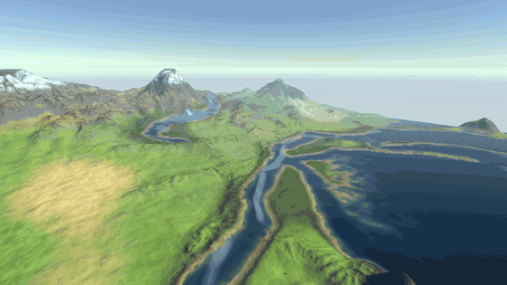
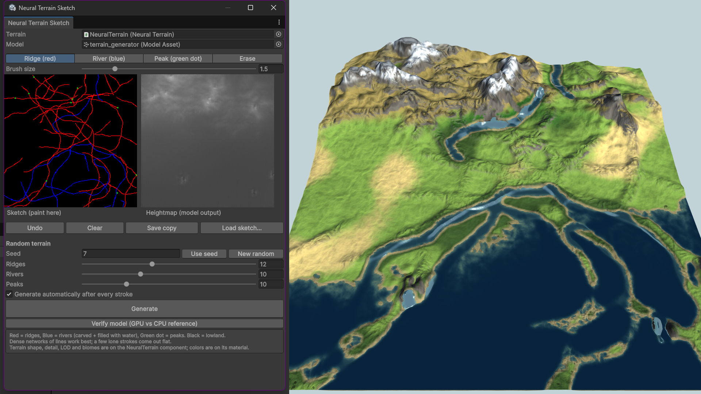
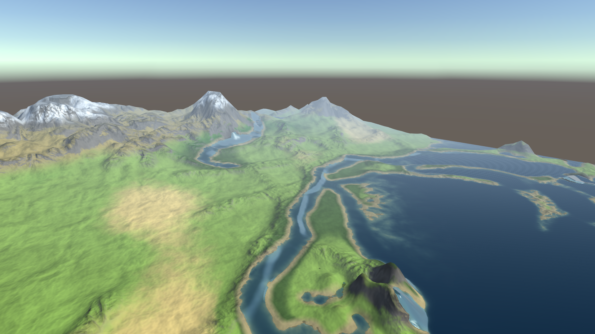
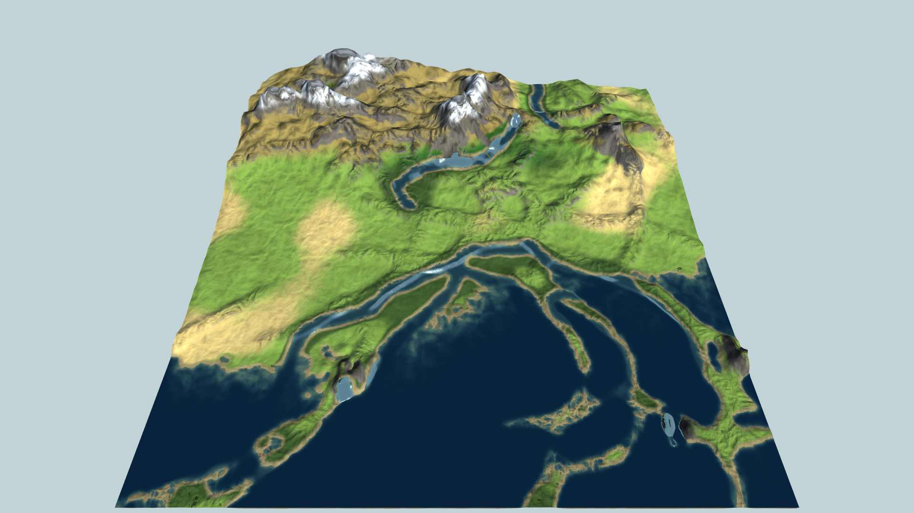
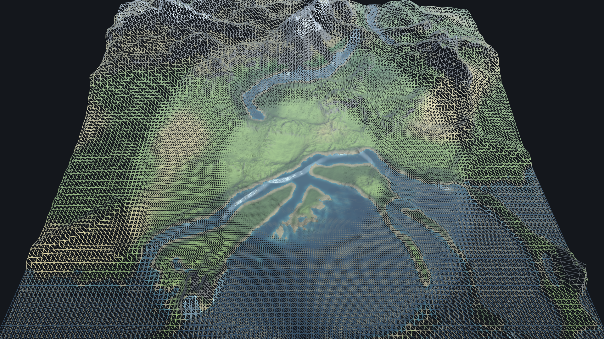
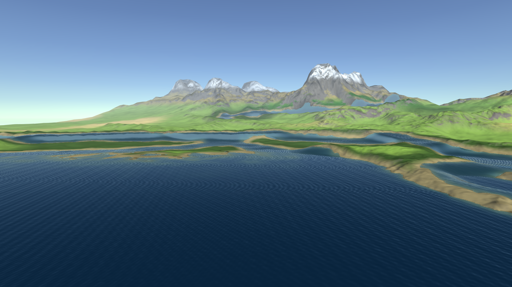
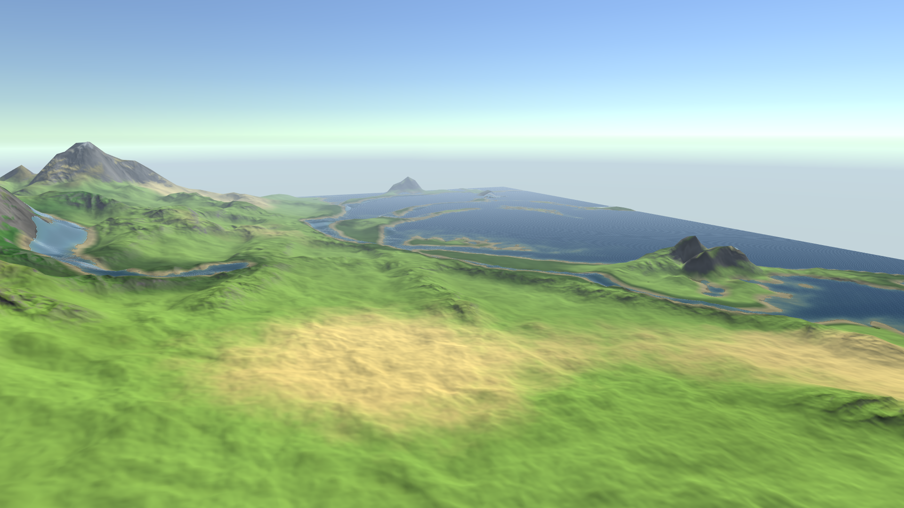
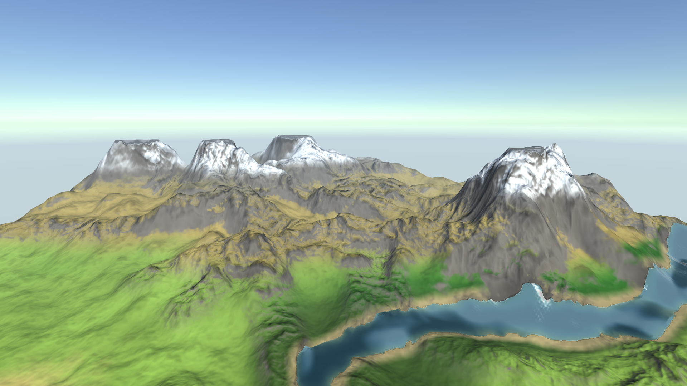

# Neural Terrain: Sketch-to-Terrain in Unity

Draw ridges, rivers and peaks in an editor window. A pix2pix network turns the sketch into a heightmap, and a CDLOD quadtree renders it as a 4 km landscape with water and blended biomes.



## Overview

Neural Terrain is an in-editor terrain authoring tool. You sketch the landscape's structure with three colors (red ridges, blue rivers, green peaks), and a conditional GAN trained on real elevation data fills in plausible terrain. The heightmap then feeds a GPU-instanced CDLOD terrain renderer with rivers, lakes, a water shader and six height x moisture biomes. The goal is the speed of a sketch with the look of real geography, all inside Unity.

## Pipeline

```
Sketch (256 x 256, editor window)
  → pix2pix generator (trained in Google Colab, PyTorch)
  → exported to ONNX
  → Unity Inference Engine (GPU compute, CPU fallback)
  → 256 x 256 heightmap
  → cleanup + upsample to 2049 x 2049 + detail noise, river carving, ridge sharpening
  → CDLOD quadtree terrain, GPU instancing, water, biomes
```

## Features

- **In-editor sketch tool** (`Window > Neural Terrain Sketch`): ridge, river, peak and erase brushes, undo, random sketch generator, live regeneration after every stroke
- **Neural heightmap** from a pix2pix model running on the Unity Inference Engine, with a built-in GPU-vs-CPU verification check
- **CDLOD quadtree terrain** (Strugar's Continuous Distance-Dependent LOD): one shared grid mesh, GPU instancing, vertex morphing between levels, no popping and no cracks
- **4 km x 4 km world** at 2 m per height sample, with about 14 draw calls for the full view
- **Rivers and lakes**: blue sketch lines carve channels and fill them with water; low basins below the lake level fill automatically
- **Water shader**: depth-based color and clarity, swell, flow-mapped ripples that follow the river downhill, sun glint, sky fresnel, shore foam and rapids
- **Six blended biomes** (Plain, Forest, Swamp, Dry hills, Desert, Mountain) chosen by height x moisture, with rock on slopes and ridges, snow, sand on shores and wet ground near water
- **Works in edit mode**: the terrain updates in the Scene view as you sketch
- **First-person walker** with swimming, for exploring at ground level

## How it works

### 1. Sketch to heightmap

`TerrainSketchModel.cs` wraps the ONNX model. The model contract (from training) is an input `sketch` of shape `(1, 3, 256, 256)` in `-1..1`, top row first, and an output `heightmap` of the same shape with all three channels equal. The sketch is converted to a tensor by hand from the raw bytes, so sRGB/linear texture settings cannot change the values. The output is flipped to Unity's bottom-up row order and the three channels are averaged, which removes small GAN artifacts on drawn lines.

`TerrainSketchModel.Verify` runs the same sketch on the GPU and on the CPU reference backend and checks four things: GPU matches CPU, output stays in `-1..1`, channels are equal, and the result is not flat.

### 2. Cleanup and baking (`NeuralTerrain.cs`)

- **Cleanup** of the 256 px output: optional auto-contrast with percentile clipping (the raw output is low-contrast), a 3 x 3 median filter to remove needle spikes at peak dots, and binomial blur passes against checkerboard artifacts.
- **Height bake** (`HeightBakeJob`, Burst, `IJobParallelFor`): bicubic Catmull-Rom upsampling to 2049 x 2049, plus fBm detail noise with optional ridged noise and domain warp. Detail is craggier along drawn ridges and calmer in river beds. Blue lines carve channels; red lines add height and sharpen crests.
- **Water bake**: a second height texture holds the water surface. Rivers sit inside their carved channels; everything below `lakeLevel` fills as a lake.
- **Mip chain** built in float precision by a Burst job (`MipJob`). Unity's own mip generation for 16-bit textures goes through 8 bits and turns distant slopes into terraces.
- **Masks**: a 256 x 256 texture packs moisture (rivers + noise + lowlands), shore and ridge masks.
- **Biome LUT**: a 64 x 64 table indexed by height and moisture. Every biome adds its color weighted by how well it fits, so borders blend smoothly and colors never pop with LOD.
- **Collider**: one `TerrainCollider` built from the same heights in play mode.

### 3. CDLOD rendering

Every frame, `OnBeginCamera` walks the quadtree from the 4096 m root down to 64 m leaves (7 levels). A node is drawn at a level when it is inside that level's distance range but outside the next finer level's range; partially covered nodes draw only the quadrants their children do not cover. Nodes outside the frustum are skipped unless they are close enough to cast shadows into view.

All nodes share **one 32 x 32 grid mesh** split into four quadrant submeshes. Each selected node becomes a matrix in one of four lists, and the lists are drawn with `Graphics.RenderMeshInstanced`, so the ground costs one instanced draw per quadrant. Water uses the same grid and is drawn only for nodes that contain water (a per-level `_waterCells` table).

In the vertex shader (`NeuralTerrainCommon.hlsl`), each grid vertex is displaced by the height texture and **morphed** toward the next coarser grid as it approaches the edge of its LOD range. Neighboring levels meet exactly, so there are no cracks and no popping. No meshes are rebuilt while you move, and the per-frame path allocates nothing.

### 4. Shading

`NeuralTerrain.shader` computes per-pixel normals and curvature from the height texture, reading a blurrier mip when one pixel covers many samples, so distant terrain stays clean. Color comes from the biome LUT, then rock on steep slopes and ridge lines, snow, sand on shores and wet darkening near water, plus fog.

`NeuralWater.shader` reads water depth as `water surface - ground` from the two textures, so it needs no camera depth texture. It layers swell on deep water, wind waves and fine ripples advected downstream with a cross-faded flow map, fresnel sky reflection, sun glint, and foam at the shoreline and on steep, fast water.

### Key scripts

| File | Role |
|---|---|
| `Scripts/NeuralTerrain.cs` | Baking (heights, water, masks, biome LUT, collider), CDLOD selection, instanced drawing |
| `Scripts/TerrainSketchModel.cs` | ONNX model wrapper: tensor conversion, inference, GPU vs CPU verification, random sketches |
| `Scripts/Editor/NeuralTerrainSketchWindow.cs` | The sketch editor window: brushes, undo, random sketches, generate, verify |
| `Scripts/BiomeDefinition.cs` | ScriptableObject: height and moisture window plus color for one biome |
| `Scripts/PlayerController.cs` | First-person walker: walk, sprint, jump, swim, mouse look |
| `Shaders/NeuralTerrainCommon.hlsl` | Shared CDLOD vertex morphing and height/mask sampling |
| `Shaders/NeuralTerrain.shader` | Ground shading (URP forward, shadow caster, depth, depth-normals) |
| `Shaders/NeuralWater.shader` | Rivers and lakes |

## Performance notes

Measured in the Unity Editor (play mode, Game view at 3840 x 2160) on an AMD Ryzen 9 7900X / RTX 4070 Ti SUPER, with `UnityStats`:

| View | Draw calls | Instanced draws | Instances | Triangles | Ground nodes | Water nodes |
|---|---|---|---|---|---|---|
| Aerial, 45° over the full 4 km map | 14 | 12 | 761 | 391 k | 62 | 54 |
| Top-down, whole 4 km map in view | 10 | 8 | 756 | 389 k | 128 | 60 |
| Low flight over the coast | 14 | 12 | 778 | 400 k | 66 | 58 |

Model and bake timings (same machine, Editor):

| Step | Time |
|---|---|
| Inference, GPU compute backend (average of 10, includes readback) | 12.4 ms |
| Inference, CPU backend (average of 3) | 28.4 ms |
| Full rebuild: cleanup, 2049² height + water bake, mips, masks, biome LUT, collider (average of 3) | 191 ms |

Model verification on the bundled sketch: **PASS**. GPU vs CPU max error 1.1e-5, output range -0.567..0.470, channel difference 7.3e-3, height std 0.138.

## Screenshots

| | |
|---|---|
|  |  |
|  |  |
|  |  |
|  | |

## Getting started

The model file is stored with **Git LFS**. Install it before cloning, or the model will be a small pointer file and inference will fail.

```bash
git lfs install
git clone https://github.com/gokulgit59/quadtree-lod-terrain-unity.git
```

If you already cloned without LFS:

```bash
git lfs pull
```

- **Unity:** 6000.5.1f1 (Unity 6.5)
- **Render pipeline:** Universal Render Pipeline (URP 17.5)
- **Packages:** Inference Engine 2.6.1, Burst, Collections, Mathematics
- **Scene:** `Assets/NeuralTerrain/Quad_terrain.unity`
- **Sketch tool:** `Window > Neural Terrain Sketch`. Paint, or press **New random**, then **Generate** (or leave auto-generate on). **Verify model** runs the GPU vs CPU check.

**Controls (play mode)**

| Input | Action |
|---|---|
| WASD | Move |
| Shift | Sprint |
| Space | Jump |
| Mouse | Look |
| Click Game view / Esc | Capture / release the mouse |

## Project structure

```
Assets/
├── NeuralTerrain/
│   ├── Quad_terrain.unity
│   ├── Scripts/            NeuralTerrain, TerrainSketchModel, BiomeDefinition, PlayerController
│   │   └── Editor/         NeuralTerrainSketchWindow
│   ├── Shaders/            NeuralTerrain, NeuralWater, NeuralTerrainCommon.hlsl, materials
│   ├── Models/             terrain_generator.onnx (Git LFS, ~218 MB)
│   ├── Terrain Objects/    six BiomeDefinition assets
│   ├── Prefabs/            NeuralTerrain, Player
│   ├── Generated/          last sketch and heightmap
│   └── Materials/          procedural sky
└── Settings/               URP asset, renderer, global settings
Media/
```

## Known limitations and future work

- **Model resolution is 256 x 256** (16 m per pixel over 4 km). Fine detail comes from procedural noise, not from the network.
- **Sketch style matters.** Dense networks of lines work best; a few lone strokes come out flat. The raw output is low-contrast, so auto-contrast is on by default. pix2pix leaves small checkerboard artifacts on drawn lines and needle peaks at green dots; the median filter and blur passes clean these up.
- The model is about 218 MB because it is the full-precision pix2pix generator. Quantizing it to FP16 would halve the size.
- One terrain tile only. The quadtree and textures cover a single 4 km area; streaming or tiling neighbors is future work.
- A full rebuild takes about 0.2 s, so very fast sketching shows a short delay after each stroke.
- Biome colors are flat per biome with procedural variation. Texture splatting and vegetation placement per biome are the next steps.

## Credits

- **Training data:** Guérin et al., *Interactive Example-Based Terrain Authoring with Conditional Generative Adversarial Networks*, ACM Transactions on Graphics (SIGGRAPH Asia 2017).
- **Model architecture:** pix2pix, Isola et al., *Image-to-Image Translation with Conditional Adversarial Networks*, CVPR 2017, trained with the [junyanz/pytorch-CycleGAN-and-pix2pix](https://github.com/junyanz/pytorch-CycleGAN-and-pix2pix) implementation in Google Colab.
- **CDLOD:** Filip Strugar, *Continuous Distance-Dependent Level of Detail for Rendering Heightmaps*, 2009.

## License

MIT, © 2026 Gokul Senthil. See [LICENSE](LICENSE).
